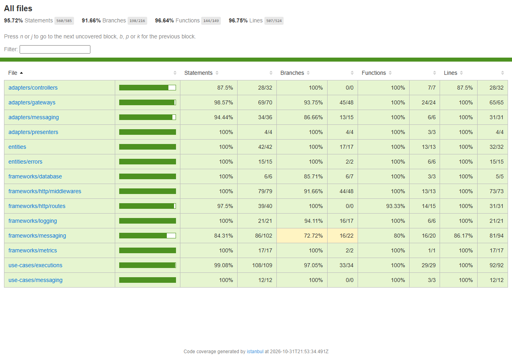

# Execution Service

Fila de execução da oficina: diagnóstico e reparo de cada ordem de serviço. É um dos três
microsserviços do Tech Challenge da Fase 4, ao lado do OS Service e do Billing Service.

As ordens entram na fila quando o OS Service pede o diagnóstico e, depois do pagamento, o reparo. O
mecânico inicia e conclui a etapa atual de cada ordem e registra o andamento de cada serviço. Cada passo
volta para o OS Service pelas filas da saga. Os dados ficam no DynamoDB.

A arquitetura do serviço, com o diagrama, as mensagens e o modelo no DynamoDB descrito por padrão de
acesso, está em [docs/architecture.md](docs/architecture.md). A arquitetura do sistema inteiro, com os ADRs
da saga, fica no repositório do OS Service, em `docs/architecture/`.

## Papel na saga

A saga é orquestrada pelo OS Service. O Execution é o participante das etapas de diagnóstico e reparo:

1. Recebe `EnqueueDiagnosis` quando a ordem é aberta e coloca a ordem na fila do mecânico.
2. Quando o mecânico inicia e conclui o diagnóstico, responde `DiagnosisStarted` e `DiagnosisCompleted`.
3. Depois do pagamento, recebe `EnqueueRepair` com os serviços pagos, e a ordem volta para o fim da fila.
4. O início e a conclusão do reparo viram `RepairStarted` e `RepairCompleted`.
5. Numa compensação, recebe `CancelExecution` e responde `ExecutionCancelled`.

Comandos chegam pela fila `execution-commands` e respostas saem pela `saga-replies`, as duas FIFO, com a
ordem como grupo de mensagens. As tabelas completas estão em
[docs/architecture.md](docs/architecture.md#mensagens).

## Repositórios

| Repositório | Papel |
|---|---|
| [fiap-tech-challenge](https://github.com/diandria/fiap-tech-challenge) | OS Service e documentação central |
| [fiap-tech-challenge-billing](https://github.com/diandria/fiap-tech-challenge-billing) | Billing Service |
| fiap-tech-challenge-execution | Este serviço |
| [fiap-tech-challenge-infra-k8s](https://github.com/diandria/fiap-tech-challenge-infra-k8s) | Cluster, gateway, filas e observabilidade |
| [fiap-tech-challenge-infra-db](https://github.com/diandria/fiap-tech-challenge-infra-db) | Banco do OS Service |
| [fiap-tech-challenge-lambda](https://github.com/diandria/fiap-tech-challenge-lambda) | Funções de autenticação e notificação |

## Execução local

Pré-requisitos: Docker e Node.js 22.

```bash
cp .env.example .env
npm install
docker compose up -d
npm run db:create-tables
```

Sobe `app` (porta 3002), `dynamodb` (DynamoDB local, porta 8000) e `localstack` (porta 4568). As portas
são diferentes das dos outros serviços, para os três poderem rodar juntos. `db:create-tables` cria no
DynamoDB local as mesmas tabelas que o Terraform cria na AWS.

| Rota | Para que serve |
|---|---|
| `GET /health` | Vivacidade; não consulta o banco |
| `GET /ready` | Prontidão; responde 503 se a tabela de execuções não responde |
| `GET /metrics` | Métricas no formato do Prometheus |
| `GET /docs` | Swagger |
| `GET /executions` | Fila do mecânico: em andamento primeiro, depois a fila, cada uma da mais antiga para a mais nova |
| `GET /executions/{serviceOrderId}` | Execução de uma ordem, com etapa, status e tarefas |
| `POST /executions/{serviceOrderId}/start` | Inicia a etapa atual (diagnóstico ou reparo) |
| `POST /executions/{serviceOrderId}/finish` | Conclui a etapa atual |
| `PATCH /executions/{serviceOrderId}/tasks/{serviceId}` | Marca início ou fim de um serviço do reparo |
| `GET /executions/stats/average-task-duration` | Média de duração de cada serviço nos reparos concluídos |

Quem pode chamar cada rota está em [docs/authorization-matrix.md](docs/authorization-matrix.md).

## Kubernetes

Os manifestos ficam em `k8s/` e seguem os do OS Service e do Billing, no namespace
`car-repair-shop-execution`, que o `infra-k8s` cria junto com o cluster.

| Recurso | Nome | Detalhe |
|---|---|---|
| ConfigMap | `execution-config` | Variáveis fixas, inclusive os nomes das tabelas |
| Service | `execution-api` | NLB interno; o API Gateway chega nele pela tag `service.k8s.aws/stack = car-repair-shop-execution/execution-api` |
| Deployment | `execution-api` | Probes em `/health` e `/ready`, rolling update de 25% |
| HPA | `execution-api` | De 2 a 4 réplicas por CPU, cabendo no cluster compartilhado com os outros serviços |
| PodDisruptionBudget | `execution-api` | Pelo menos uma réplica durante a drenagem de um node |

Não há Job de migração: o DynamoDB não tem schema a migrar, e as tabelas vêm do Terraform deste repositório.
O pipeline de deploy cria o ConfigMap `execution-runtime` (URLs das filas da saga) e o Secret
`execution-secret` (`JWT_SECRET`). O pod acessa o DynamoDB com o papel do node, sem credencial própria. O CI
valida os manifestos com `kubeconform -strict`.

## Infraestrutura

As tabelas do Execution são provisionadas por este repositório, na pasta `terraform/`, com estado próprio
(`execution/terraform.tfstate`, no mesmo bucket dos outros repositórios). Nenhum outro estado é lido: o
DynamoDB não precisa de rede nem de security group, então um `apply` aqui não depende de nada. Filas,
cluster e registro de imagens são plataforma compartilhada e ficam no `infra-k8s`.

| Tabela | Chave | Detalhe |
|---|---|---|
| `car-repair-shop-executions` | `serviceOrderId` | Índice `status-queuedAt`, que serve a fila do mecânico |
| `car-repair-shop-execution-outbox` | `messageId` | Respostas à saga esperando publicação |
| `car-repair-shop-execution-processed-messages` | `messageId` | Comandos já tratados; expiram em 30 dias pelo atributo `expiresAt` |

As três usam cobrança por requisição e a criptografia padrão do DynamoDB. A recuperação ponto a ponto fica
desligada porque o ambiente é recriado a cada ciclo; em produção, ela seria ligada na tabela de execuções.
`scripts/dynamodb/tables.ts` cria as mesmas tabelas no DynamoDB local, e os nomes e o índice precisam
continuar iguais aos do Terraform.

As pipelines de infraestrutura só rodam quando `terraform/` muda:

| Workflow | Quando | O que faz |
|---|---|---|
| `Infra CI` | Pull request | `fmt`, `validate`, `tflint` e `trivy`; não precisa de credencial |
| `Infra CD` | Merge na `main` | `apply` e confirmação de que a tabela de execuções está ativa e tem o índice da fila |
| `Infra destroy` | Manual, digitando `production` | `destroy` do ambiente |

O `Infra CD` e o `Infra destroy` usam os segredos `AWS_ACCESS_KEY_ID`, `AWS_SECRET_ACCESS_KEY` e
`AWS_SESSION_TOKEN` do repositório, que precisam ser atualizados a cada sessão do Learner Lab.

## CI/CD

O `CI` roda em todo pull request e em todo push na `main`: build, lint, testes, cobertura, validação dos
manifestos e a análise no [SonarQube Cloud](https://sonarcloud.io/project/overview?id=diandria_fiap-tech-challenge-execution), que reprova
o PR quando o quality gate reprova (`sonar.qualitygate.wait`) ou quando o segredo `SONAR_TOKEN` falta. O `CD` dispara quando o `CI` termina verde na `main` e publica o serviço no EKS, no namespace
`car-repair-shop-execution`:

1. Build da imagem e push no ECR `car-repair-shop-execution`, com a tag do SHA curto do commit.
2. Leitura de `JWT_SECRET` no SSM (`/car-repair-shop/auth/jwt-secret`, escrito pelo Terraform das
   functions) e das URLs das filas `execution-commands` e `saga-replies`, criadas pelo `infra-k8s`. Se algum
   valor faltar, o deploy para com `required value missing or empty: <nome>`.
3. Confirmação de que as três tabelas existem e estão `ACTIVE`. Os nomes são lidos do próprio
   `k8s/01-config/configmap.yaml`, então a checagem e a aplicação não têm como olhar para tabelas diferentes.
   Sem essa etapa, uma tabela ausente só apareceria como pods que nunca passam na readiness.
4. ConfigMap `execution-runtime` e Secret `execution-secret`, seguidos dos manifestos de `k8s/`.
5. Troca da imagem do Deployment e espera do rollout; se ele não fica pronto em 5 minutos, o CD volta para
   a revisão anterior e termina com erro.
6. Verificação de `/ready` dentro de um pod, que confirma também o acesso ao DynamoDB pelo papel do node.

Não há etapa de migration, porque as tabelas vêm do Terraform. Os únicos segredos do GitHub são os três da
AWS, e cada deploy fica registrado em **Deployments → production**.

## Testes

```bash
npm test                # unitários e de integração (o Testcontainers sobe DynamoDB local e LocalStack)
npm run test:coverage   # com relatório de cobertura; o mínimo é 80%
```

Os testes de integração seguem o padrão GIVEN / WHEN / THEN.

### Cobertura

O mínimo de 80% vale para linhas, branches, funções e statements, e o `npm run test:coverage` falha abaixo
dele. O job `Coverage` do [CI](https://github.com/diandria/fiap-tech-challenge-execution/actions/workflows/ci.yml)
roda em todo PR e guarda o relatório HTML como artefato do run. O mesmo relatório alimenta a análise do
[SonarQube Cloud](https://sonarcloud.io/project/overview?id=diandria_fiap-tech-challenge-execution).

| Linhas | Statements | Funções | Branches |
|---|---|---|---|
| 96,75% | 95,72% | 96,64% | 91,66% |


