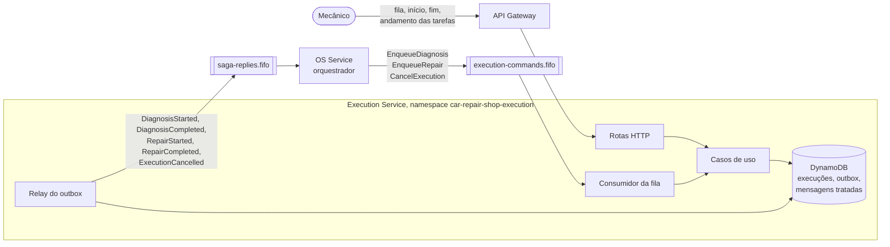

# Arquitetura do Execution Service

O Execution é dono da fila de trabalho da oficina: o diagnóstico e o reparo de cada ordem de serviço. Ele
não decide quando uma ordem entra na fila; quem decide é o orquestrador da saga, no OS Service. O
Execution enfileira o que recebe, registra o que o mecânico faz e avisa a saga a cada mudança de etapa.

## Visão do serviço



Cada mudança na execução e a resposta correspondente à saga são gravadas num único `TransactWriteItems`:
a execução, condicionada à versão lida; a resposta, na tabela de outbox; e, quando a mudança veio de um
comando, o id dele na tabela de mensagens tratadas. Ou as três gravações acontecem, ou nenhuma. O relay
publica o outbox depois e apaga cada mensagem enviada.

## Camadas

A mesma Clean Architecture do OS Service e do Billing, com as dependências apontando para dentro.

| Camada | Pasta | O que tem |
|---|---|---|
| Entidades | `src/entities/` | `Execution`, com as transições permitidas: enfileirar o reparo só depois do diagnóstico concluído, iniciar só o que está na fila, concluir só o que está em andamento |
| Casos de uso | `src/use-cases/` | Enfileirar diagnóstico e reparo, iniciar e concluir a etapa, registrar o andamento das tarefas, cancelar, listar a fila e calcular a média por serviço. As portas ficam em `ports/` |
| Adaptadores | `src/adapters/` | Controllers, repositório e store do DynamoDB, handler dos comandos e presenters |
| Frameworks | `src/frameworks/` | Express, cliente do DynamoDB, SQS, OpenTelemetry, Prometheus e a montagem em `main.ts` |

O DynamoDB aparece para os casos de uso só como `IExecutionRepository` (leitura) e `IExecutionStore`
(gravação atômica com outbox). Nenhuma regra de negócio conhece o DynamoDB.

## Mensagens

Comandos consumidos de `car-repair-shop-execution-commands.fifo`:

| Comando | O que o Execution faz | Resposta |
|---|---|---|
| `EnqueueDiagnosis` | Cria a execução na etapa `DIAGNOSIS`, com status `QUEUED` | Nenhuma na hora; a próxima vem quando o mecânico inicia |
| `EnqueueRepair` | Passa a execução para a etapa `REPAIR`, de novo na fila, com os serviços pagos como tarefas | Nenhuma na hora |
| `CancelExecution` | Tira da fila uma ordem que ainda está no diagnóstico | `ExecutionCancelled`, sempre, mesmo sem nada a cancelar |

Respostas publicadas em `car-repair-shop-saga-replies.fifo`:

| Resposta | Origem |
|---|---|
| `DiagnosisStarted` e `DiagnosisCompleted` | `POST /executions/{id}/start` e `/finish` na etapa de diagnóstico |
| `RepairStarted` e `RepairCompleted` | As mesmas rotas, na etapa de reparo |
| `ExecutionCancelled` | Comando `CancelExecution` |

A resposta sempre enviada no cancelamento é de propósito: o orquestrador espera por ela para encerrar a
compensação, e uma compensação que falha deixaria a saga aberta. Um comando que falha cinco vezes vai
para a fila de descarte, e o OS trata a falha.

O envelope e as regras de ordenação e deduplicação estão no ADR-015, no repositório do OS Service.

## Modelo no DynamoDB

O modelo partiu das consultas, não das entidades: cada padrão de acesso tem uma chave ou um índice que
o atende sem varrer a tabela.

### Tabela `car-repair-shop-executions`

Um item por ordem de serviço, com chave `serviceOrderId`. As tarefas do reparo ficam embutidas no item,
porque são sempre lidas e gravadas junto com a execução, e a lista é só a dos serviços de uma ordem.

```json
{
  "serviceOrderId": "0b6f...",
  "stage": "REPAIR",
  "status": "IN_PROGRESS",
  "queuedAt": "2026-10-31T13:02:11.000Z",
  "startedAt": "2026-10-31T13:20:40.000Z",
  "tasks": [
    { "serviceId": "7c1e...", "name": "Troca de óleo", "startedAt": "2026-10-31T13:21:02.000Z" }
  ],
  "version": 4
}
```

| Padrão de acesso | Como é atendido |
|---|---|
| Execução de uma ordem | `GetItem` pela chave `serviceOrderId` |
| Fila do mecânico: o que está em andamento e o que está esperando, do mais antigo para o mais novo | `Query` no índice `status-queuedAt`, uma por status (`IN_PROGRESS` e depois `QUEUED`), com `queuedAt` crescente |
| Média de duração de cada serviço | `Query` no mesmo índice com status `DONE` e filtro na etapa `REPAIR` |
| Gravar uma mudança sem perder a de outra pessoa | `ConditionExpression` sobre `version` (`attribute_not_exists` na criação) |

`queuedAt` é reescrito quando a ordem volta para a fila do reparo, e é isso que coloca o reparo no fim da
fila em vez de na posição do diagnóstico.

### Tabelas `car-repair-shop-execution-outbox` e `car-repair-shop-execution-processed-messages`

As duas têm chave `messageId`. O outbox guarda só o que ainda não foi publicado; como fica quase sempre
vazio, o relay lê com um `Scan` limitado e ordena em memória. A tabela de mensagens tratadas usa
`attribute_not_exists(messageId)` dentro da transação para recusar um comando repetido, e cada item expira
em 30 dias pelo TTL em `expiresAt`, muito além da janela de deduplicação de cinco minutos das filas FIFO.
